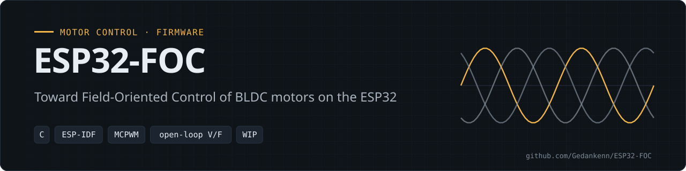
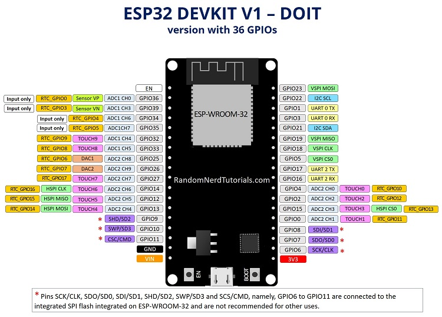

<p align="center"></p>

<p align="center">
  
  
  
  
</p>

**ESP32-FOC** is ESP-IDF firmware for the ESP32 that works toward Field-Oriented Control (FOC) of a BLDC motor. As a first step it runs **open-loop V/F (volts-per-hertz) control** through a six-switch inverter.

> **Status: work in progress.** Today: open-loop V/F with a potentiometer speed reference. FOC (Clarke/Park, current loops) is documented below but not yet implemented.

Related: [3-phase-inverter](https://github.com/Gedankenn/3-phase-inverter) (power stage) · [OTPC](https://github.com/Gedankenn/OTPC) (PMSM traction controller, simulation-first) · [BLDC + EKF simulation](https://github.com/Gedankenn/Python-Simulation-of-BLDC-motor-using-Kalman-Filter)

---

## Overview

| Item | Detail |
|---|---|
| **Control** | Open-loop V/F, FreeRTOS task `OpenLoopVF_Control` (`main/application/src/VF.c`) |
| **Speed reference** | Potentiometer on **GPIO 36 (ADC1 channel 0)**, raw 0–4095 → 0–10 000 rpm, ESP-IDF `adc_oneshot` driver |
| **V/F gain** | `Gf = 12 V / 10 000 rpm`, phase voltage clamped at 12 V |
| **PWM** | **MCPWM unit 0** (legacy `driver/mcpwm.h` API), three half-bridges at **1 kHz**, short delay between switching one side off and the other on |
| **Driver enable** | **GPIO 22**, set low at boot |
| **Target motor** | A2212/13T brushless motor (see [Motor specs](#motor-specs)) |

## Features

- [x] ADC speed reference (oneshot driver)
- [x] Electrical-angle integration from the reference speed
- [x] V/F voltage command with 12 V clamp
- [x] Three sinusoidal phase duties at 120° offsets driving MCPWM
- [ ] Field-Oriented Control: Clarke/Park transforms and dq current loops (the goal of this repo; math in [Theory](#theory))

## Hardware

### Pin map (`main/driver/inc/gpio.h`)

| Signal | GPIO |
|--------|------|
| PWM0A / PWM0B (phase A high / low) | 15 / 2 |
| PWM1A / PWM1B (phase B high / low) | 4 / 16 |
| PWM2A / PWM2B (phase C high / low) | 17 / 5 |
| Driver enable | 22 |
| Speed reference (potentiometer, ADC1_CH0) | 36 |

The inverter hardware is documented in [3-phase-inverter](https://github.com/Gedankenn/3-phase-inverter).

<details>
<summary><b>ESP32 DevKit pinout</b></summary>



</details>

### Motor specs

Target motor: **A2212/13T** brushless motor.

| Parameter | Value |
|---|---|
| Resistance | 0.090 Ω |
| Poles | 14 |
| Inductance | 0.1 mH |

## Architecture

```text
ADC (GPIO 36) ──▶ OpenLoopVF_Control task ──▶ UpdateSpeed() ──▶ update_motor_speed_callback() ──▶ MCPWM unit 0 ──▶ 3 half-bridges
   speed ref        θ += ω·T, V = ref·Gf        duty scaling        sin(θ), sin(θ ± 2π/3)            1 kHz
```

```text
ESP32-FOC/
├── CMakeLists.txt              # ESP-IDF project file
├── sdkconfig                   # ESP32 target, generated with ESP-IDF 5.1.0
├── main/
│   ├── main.c                  # app_main: init ADC, GPIO, PWM; start the V/F task
│   ├── application/            # VF.c / VF.h: open-loop V/F control task
│   └── driver/                 # adc.c, gpio.c, PWM.c (+ headers in inc/)
├── figures/                    # ESP32 DevKit pinout
└── .devcontainer/              # VS Code dev container based on the espressif/idf image
```

## Build & Flash

ESP-IDF project for the **ESP32**. The `sdkconfig` was generated with ESP-IDF 5.1.0; the code uses the legacy MCPWM driver, which is deprecated in newer ESP-IDF releases.

```bash
. $IDF_PATH/export.sh
idf.py set-target esp32
idf.py build
idf.py -p /dev/ttyUSB0 flash monitor   # replace with your serial port
```

A VS Code dev container (`.devcontainer/`, based on `espressif/idf`) is included as an alternative build environment.

## Usage

Power the inverter, flash the firmware and turn the potentiometer: the reference speed (and with it the V/F voltage) follows the ADC reading.

### How the V/F loop works

V/F is an open-loop method: the phase-voltage amplitude is the reference speed times a fixed gain.

$$
    G_f = \frac{V_{max}}{\omega_{max}} \qquad V = G_f \, \omega_{ref}
$$

The control task integrates the electrical angle and computes the voltage command (`main/application/src/VF.c`):

```c
rad   = ref * gain_adc * rpm_to_rad;          // reference speed, rad/s
theta = fmod((theta + rad * T_adc), (2 * pi)); // electrical angle
Volts = ref * Gf * gain_adc;                   // V/F law
if (Volts >= Tmax) Volts = Tmax;               // clamp
UpdateSpeed(Volts, theta);
```

The three phase duties are 120° apart (`main/driver/src/PWM.c`):

```c
duty_A = comp_value * FEM_sin(theta) + 80;
duty_B = comp_value * FEM_sin(theta + 2.0 * pi / 3.0) + 80;
duty_C = comp_value * FEM_sin(theta - 2.0 * pi / 3.0) + 80;
```

Changing ω changes the voltage, so the motor speeds up or slows down with the reference.

## Theory

### Mathematical model of the BLDC motor

$$
\frac{d}{dt}
\left(\begin{array}{c}
I_a\\
I_b \\
I_c \\
\omega_r \\
\theta_e
\end{array}\right)
= \left(\begin{array}{ccccc}
-\frac{R}{L-M} & 0 & 0 & -\frac{P_p\phi_mF_a(\theta_e)}{L-M} & 0\\
0 & -\frac{R}{L-M} & 0 & -\frac{P_p\phi_mF_b(\theta_e)}{L-M} & 0\\
0 & 0 & -\frac{R}{L-M} & -\frac{P_p\phi_mF_c(\theta_e)}{L-M} & 0\\
\frac{P_p\phi_mF_A(\theta_e)}{J} & \frac{P_p\phi_mF_B(\theta_e)}{J} & \frac{P_p\phi_mF_C(\theta_e)}{J} & -\frac{B}{J} & 0 \\
0 & 0 & 0 & P_p & 0
\end{array}\right)
\left(\begin{array}{c}
I_a \\
I_b \\
I_c \\
\omega_r \\
\theta_e
\end{array}\right)
+
\left(\begin{array}{cccc}
\frac{1}{L-M} & 0 & 0 & 0\\
0 & \frac{1}{L-M} & 0 & 0\\
0 & 0 & \frac{1}{L-M} & 0\\
0 & 0 & 0 & -\frac{1}{J} \\
0 & 0 & 0 & 0
\end{array}\right)
\left(\begin{array}{c}
V_an \\
V_bn \\
V_cn \\
T_c
\end{array}\right)
$$

### FOC transforms

#### Clarke transform

$$
    \left(\begin{array}{c}
    V_0 \\
    V_\alpha \\
    V_\beta
    \end{array}\right)
    =
    \sqrt{\frac{2}{3}}
    \left(\begin{array}{ccc}
    \sqrt{\frac{1}{2}} & \sqrt{\frac{1}{2}} & \sqrt{\frac{1}{2}} \\
    1 & -\frac{1}{2} & -\frac{1}{2} \\
    0  & \frac{\sqrt{3}}{2} & -\frac{\sqrt{3}}{2}
    \end{array}\right)
    \left(\begin{array}{c}
    V_A \\
    V_B \\
    V_C
    \end{array}\right)
$$

#### Inverse Clarke transform

$$
    \left(\begin{array}{c}
    V_A \\
    V_B \\
    V_C
    \end{array}\right)
    =
    \left(\begin{array}{ccc}
    \frac{\sqrt{2}}{2} & 1 & 0\\
    \frac{\sqrt{2}}{2} & -\frac{1}{2} & \frac{\sqrt{3}}{2} \\
    \frac{\sqrt{2}}{2} & -\frac{1}{2} & -\frac{\sqrt{3}}{2}
    \end{array}\right)
    \left(\begin{array}{c}
    V_0 \\
    V_\alpha \\
    V_\beta
    \end{array}\right)
$$

#### Park transform

$$
    \left(\begin{array}{c}
    V_d \\
    V_q
    \end{array}\right)
    =
    \left(\begin{array}{cc}
    \cos(\theta) & \sin(\theta) \\
    -\sin(\theta) & \cos(\theta)
    \end{array}\right)
    \left(\begin{array}{c}
    V_\alpha \\
    V_\beta
    \end{array}\right)
$$

#### Inverse Park transform

$$
    \left(\begin{array}{c}
    V_\alpha \\
    V_\beta
    \end{array}\right)
    =
    \left(\begin{array}{cc}
    \cos(\theta) & -\sin(\theta) \\
    \sin(\theta) & \cos(\theta)
    \end{array}\right)
    \left(\begin{array}{c}
    V_d \\
    V_q
    \end{array}\right)
$$

#### Motor constants

$$
K_v = \frac{\omega_{rpm}}{V_P \cdot 0.95}
$$

$K_v$ is the motor voltage constant: roughly, how many rpm the motor turns per volt.

$$
K_p = \frac{60}{2 \pi K_v} \quad (K_v \text{ in rpm/V}) \qquad\qquad K_p = \frac{1}{K_v} \quad (K_v \text{ in rad/s per V})
$$

## License

No license file has been added to this repository yet.

---
<sub>Part of <a href="https://github.com/Gedankenn">Fabio Slika Stella's</a> embedded work · <a href="https://gedankenn.github.io/Gedankenn/">portfolio</a></sub>
